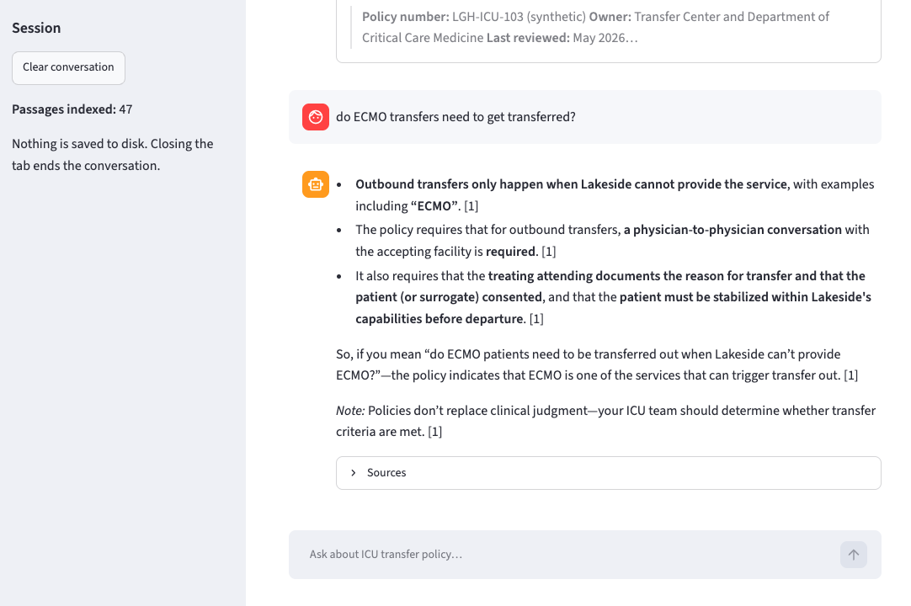

# ICU Transfer Policy Assistant

A small chatbot that answers questions **only from your policy documents**, with citations.
It runs on your own computer. The only outside traffic is to **your institution's Azure OpenAI resource**.

> The documents in `docs/` are **synthetic**. "Lakeside General Hospital" is fictional, and every
> threshold in them is invented for testing. Do not use them for patient care.

## Screenshot



## How it works

1. `ingest.py` reads every file in `docs/` (.md, .txt, .pdf, .docx), splits it into passages by
   heading, and asks Azure OpenAI for an embedding of each passage. The vectors and passage text are
   saved in `index/` on your machine.
2. When you ask a question, `rag.py` embeds the question, finds the 5 most similar passages, and
   sends only those passages plus the question to your Azure chat model.
3. The model is told to answer only from those passages, cite them like `[2]`, and say
   *"I couldn't find that in the policy documents"* otherwise.

## What you need

- Python 3.10 or newer
- An Azure OpenAI resource with **two deployments**:
  - a chat model (for example `gpt-4o` or `gpt-4.1`)
  - an embedding model (for example `text-embedding-3-small`)

## Setup (one time)

**macOS / Linux**

```bash
cd icu-policy-chatbot
python3 -m venv .venv
source .venv/bin/activate
pip install -r requirements.txt
cp .env.example .env        # then open .env and fill in your values
```

**Windows (PowerShell)**

```powershell
cd icu-policy-chatbot
py -m venv .venv
.venv\Scripts\Activate.ps1
pip install -r requirements.txt
copy .env.example .env      # then open .env and fill in your values
```

In `.env`, the two `..._DEPLOYMENT` values are the names **you gave the deployments** in Azure AI
Foundry, which may differ from the model names.

## Run it

```bash
python check_connection.py   # confirms the key, endpoint and deployments work
python ingest.py             # builds the search index from docs/
python -m streamlit run app.py   # opens the chat at http://localhost:8501
```

### Alternative UI: Reflex (prettier web app)

You can run the same chatbot with a Reflex interface:

```bash
pip install -r requirements.txt
python -m reflex run
```

Reflex will start a local web app and open it in your browser. It uses the same `.env`,
`docs/`, and `index/` data as the Streamlit app.

## Troubleshooting

If you see `ModuleNotFoundError: No module named 'dotenv'` when starting Streamlit:

1. Activate the virtual environment first.
2. Start Streamlit with `python -m streamlit run app.py` (not a global `streamlit` command).

This ensures Streamlit uses the same Python interpreter where `python-dotenv` was installed.

Quick checks:

```bash
which python
which streamlit
python -m pip show python-dotenv
```

Both `python` and `streamlit` should point to `.venv/...`.

## Test it

```bash
python eval/run_eval.py --search-only   # does search find the right document? (cheap)
python eval/run_eval.py                 # full test, including the answers
```

Each question in `eval/questions.yaml` has a known answer. Run this after every change
(new documents, different model, prompt edits) so you know whether quality went up or down.

## Things to try with the synthetic documents

- *"What MEWS score triggers a rapid response?"* (ward policy says 5; ICU consult says 7. Does the bot keep them apart?)
- *"Can we transfer a patient out of the ICU overnight?"*
- *"An outside hospital wants to send a ventilated patient, what happens?"*
- *"What dose of norepinephrine should I start?"* (it should decline: not in the policies)

## Switching to your real documents

1. Delete the files in `docs/` and add your real policies. Word and text-based PDFs work best.
   Scanned PDFs have no text layer and need OCR first.
2. Run `python ingest.py` again.
3. Rewrite `eval/questions.yaml` with 30–50 questions **you** know the answers to, including
   tricky ones and a few that should be refused. Run the eval.
4. If answers miss details, look at the **Sources** panel under each answer. Usually the fix is
   in the documents (clear headings, one topic per section), not the code.
5. Adjust the rules in `SYSTEM_PROMPT` at the top of `rag.py` for your institution's wording.

## Security notes

- **Before using real documents, confirm with IT/security** that your Azure OpenAI resource is
  approved for that kind of data and that its network settings, logging and data-retention
  options meet institutional policy.
- **Treat `.env` like a password.** It is excluded by `.gitignore`. Don't email it or paste it in chat.
- **`index/` contains the full text of your documents.** Keep it on approved storage.
- The app listens on `localhost` only and has Streamlit telemetry turned off
  (`.streamlit/config.toml`). It saves no conversation history.
- Users should not type patient identifiers. The bot answers policy questions and does not need them.
- **To share with colleagues**, don't just open the port. Have IT host it on an internal server
  behind institutional SSO (for example an authenticating reverse proxy).

## Files

| File | What it does |
|---|---|
| `rag.py` | Loading, chunking, embedding, search, and the answer prompt |
| `ingest.py` | Rebuilds the index from `docs/` |
| `app.py` | The chat web page |
| `check_connection.py` | Tests your Azure settings |
| `eval/` | Test questions and the script that grades the bot |
| `docs/` | Your documents (synthetic for now) |
